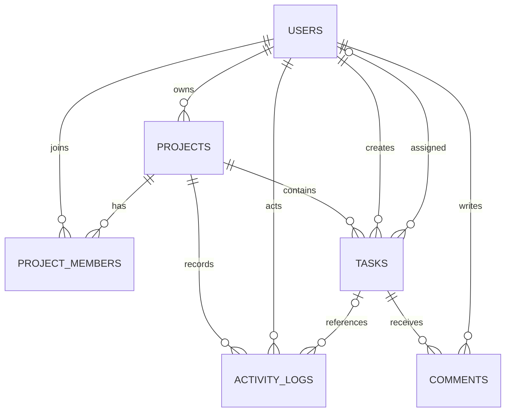

# TeamBoard database design

MySQL + Sequelize. Thiết kế logic theo kế hoạch, chưa áp dụng migration.

| Bảng | Cột chính | Ghi chú |
| --- | --- | --- |
| users | id, name, email (unique), password_hash, created_at |  |
| projects | id, name, description, join_code (unique), owner_id (FK), created_at |  |
| project_members | project_id (FK), user_id (FK), role (owner/member), joined_at | Khóa chính ghép |
| tasks | id, project_id (FK), title, description, status, priority, due_date, assignee_id (FK), created_by (FK), created_at, updated_at | status: todo, doing, review, done |
| comments | id, task_id (FK), user_id (FK), content, created_at |  |
| activity_logs | id, project_id (FK), user_id (FK), task_id (FK, null được), action, detail, created_at | action: task_created, task_moved, comment_added... |

## Ràng buộc và đề xuất triển khai

- ID dùng cùng kiểu số nguyên cho PK/FK. Email và join code unique. project_members có PK (project_id, user_id). Khi tạo project, ghi project và membership owner trong một transaction.
- Task mặc định todo và priority medium. due_date là DATE, assignee_id có thể bỏ trống. Khi có người nhận việc, API xác thực họ thuộc project trước khi lưu. created_by lấy từ token.
- Tạo index theo các truy vấn dự kiến: project_members(user_id), tasks(project_id, status), tasks(project_id, assignee_id), comments(task_id, created_at), activity_logs(project_id, created_at).
- Đề xuất xóa task giữ nhật ký với task_id NULL, xóa comment thuộc task. Xóa project chỉ dành cho owner và cần xóa các bản ghi phụ thuộc nhất quán. Chính sách giữ dữ liệu và hành vi FK khi xóa cần hai thành viên duyệt trước migration.
- Chứng minh lưu trữ: tạo task từ UI, đọc qua API, khởi động lại API rồi tải lại Board để thấy cùng task ID và trạng thái.
